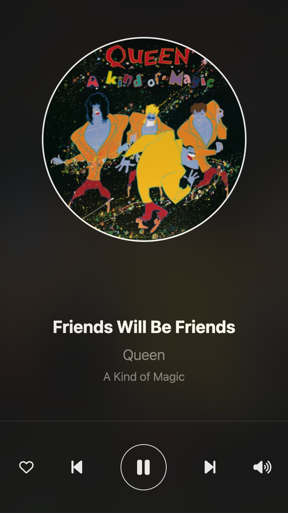

# Remote Controller

Koel has a built-in remote controller that lets you control a desktop instance.

## Configuration


In order for the remote controller to work, [register](https://dashboard.pusher.com/accounts/sign_up) for a Pusher account
and create an app. Then, populate the app's credentials into `.env`:

```
PUSHER_APP_ID=
PUSHER_APP_KEY=
PUSHER_APP_SECRET=
PUSHER_APP_CLUSTER=
```

Finally, reload your Koel instance to apply the changes.

### Using your own server

Instead of Pusher, you can run [Laravel Reverb](https://reverb.laravel.com), which comes with Koel. Set these in `.env`:

```
BROADCAST_CONNECTION=reverb
REVERB_APP_ID=my-koel
REVERB_APP_KEY=any-random-string
REVERB_APP_SECRET=another-random-string
REVERB_HOST=ws.example.com
REVERB_PORT=443
REVERB_SCHEME=https
```

Then keep `php artisan reverb:start` running (with Supervisor, for example). It listens on port 8080; have your web server pass all traffic for `REVERB_HOST` (WebSocket and HTTP) to it. See [Reverb's docs](https://laravel.com/docs/reverb#production) for an nginx example.

The [Docker image](https://github.com/koel/docker#background-jobs-and-live-updates) and the
[standalone binary](../guide/standalone-binary.md#live-updates-with-reverb) run Reverb for you.

## Usage

You can access the remote controller by visiting `https://<your-koel-domain>/remote`.

:::tip
You can pin the remote controller to your phone's home screen for quick access.
:::

The remote controller will scan for an active Koel instance.
If found, it will connect to it and allow you to control the playback as well as like/unlike the current song and adjust the volume.



